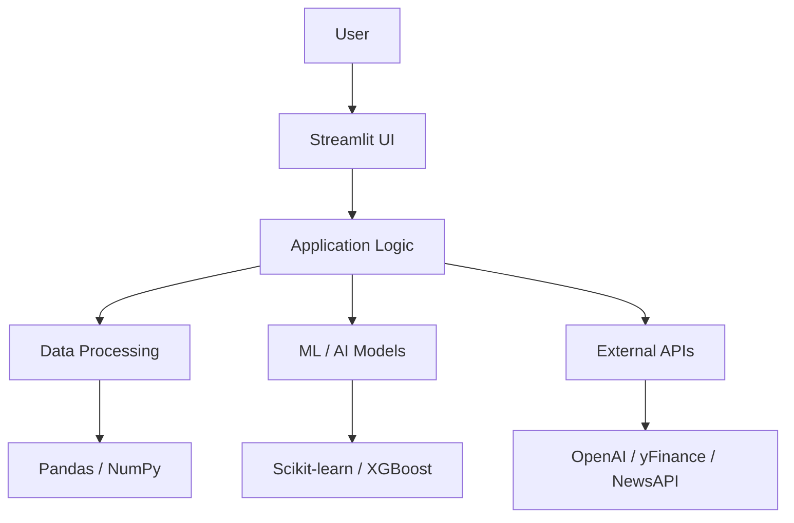

<p align="center">
  <h1 align="center">Advanced Data Science Suite</h1>
  <p align="center">
    <strong>Production‑ready analytics, machine learning, and AI demos</strong>
    <br />
    <a href="#"><strong>🌐 Live Demo</strong></a>
    ·
    <a href="#"><strong>🐛 Report Bug</strong></a>
    ·
    <a href="#"><strong>💬 Discussions</strong></a>
  </p>
</p>

<p align="center">
  
  
  
  
</p>

---

## 📖 Table of Contents

- [✨ Overview](#-overview)
- [📦 Applications](#-applications)
- [🏗️ Architecture](#%EF%B8%8F-architecture)
- [🛠️ Installation & Setup](#%EF%B8%8F-installation--setup)
- [▶️ Running the Suite](#%EF%B8%8F-running-the-suite)
- [📂 Project Structure](#-project-structure)
- [⚙️ Configuration](#%EF%B8%8F-configuration)
- [🧪 Development](#-development)
- [🔐 Security](#-security)
- [🤝 Contributing](#-contributing)
- [📄 License](#-license)

---

## ✨ Overview

This repository contains a **collection of advanced, interactive data science applications** built with Streamlit. Each app demonstrates cutting‑edge techniques in **machine learning, natural language processing, computer vision, time series, and explainable AI**. The suite is designed to be modular, extensible, and ready for both learning and prototyping.

| 🧩 **App** | 🎯 **Focus** | 🔧 **Key Technologies** |
|------------|--------------|---------------------------|
| **Decision Tree Explorer** | Interpretable ML | SHAP, counterfactuals, pruning, model distillation |
| **Sentiment Analyzer** | NLP & text mining | TextBlob, emotion detection, aspect extraction, word clouds |
| **Stock Analyzer** | Financial analytics | yFinance, technical indicators, news sentiment, risk metrics |
| **Market Basket Analyzer** | Association rules | Apriori/FP‑Growth, lift/confidence, business scoring |
| **Binning Analyzer** | Data discretization | Auto‑bin suggestions, statistical tests, LLM insights |
| **Data Cleaning Assistant** | Data preparation | Anomaly detection, smart imputation, PII masking, synthetic data |
| **K‑Means Clustering** | Unsupervised learning | Auto‑K selection, stability, sub‑cluster discovery, PCA/UMAP |
| **Music Analyzer** | Audio intelligence | Librosa, genre classification, cross‑modal search, playlist generation |
| **Movie Recommender** | Recommendation systems | TF‑IDF, collaborative filtering, hybrid, cold‑start, LLM explanations |
| **Geospatial Platform** | Spatial analytics | Interactive maps, route optimization, environmental modeling |

---

## 📦 Applications

Each app is a self‑contained Streamlit module. A quick overview:

| App | Description |
|-----|-------------|
| `decision_tree.py` | Train decision trees/random forests with SHAP explanations, counterfactual examples, pruning suggestions, and business rule extraction. |
| `sen.py` | Analyze sentiment, emotions, aspects, and topics from text; includes trend forecasting and interactive visualizations. |
| `stock.py` | Fetch live stock data, compute technical indicators, detect chart patterns, assess risk, and generate portfolio recommendations. |
| `association_rules.py` | Discover product associations using Apriori/FP‑Growth, with AI‑powered explanations and business scoring. |
| `binning_app.py` | Optimize binning of numeric data using equal‑width, equal‑frequency, K‑Means, or dynamic optimization; includes statistical testing and LLM interpretations. |
| `cleaning_assisstant.py` | Automate data cleaning: schema inference, outlier detection, imputation, privacy transformations, and quality reporting. |
| `cluster.py` | Perform K‑Means clustering with automatic K selection, stability analysis, sub‑cluster discovery, and rule‑based or LLM cluster labeling. |
| `music.py` | Extract audio features (MFCC, chroma, tempo), classify genre, generate playlists, and perform cross‑modal search. |
| `movie.py` | Build recommendation systems using content‑based, collaborative, and hybrid approaches with session tracking and AI explanations. |
| `geo.py` | Visualize geospatial data on interactive maps, analyze temporal trends, simulate fleet tracking, and query via a chatbot. |

---

## 🏗️ Architecture



All apps share:
- **Streamlit** for the frontend
- **Pandas & NumPy** for data handling
- **Scikit‑learn** for classical ML
- **Plotly** for interactive visualizations
- **OpenAI** (optional) for LLM‑powered explanations

---

## 🛠️ Installation & Setup

### Prerequisites

- Python 3.10+
- pip
- (Optional) OpenAI API key for LLM features

### Step 1: Clone the Repository

```bash
git clone https://github.com/yourusername/advanced-data-science-suite.git
cd advanced-data-science-suite
```

### Step 2: Create a Virtual Environment

```bash
python -m venv .venv
source .venv/bin/activate      # Linux/macOS
.venv\Scripts\activate         # Windows
```

### Step 3: Install Dependencies

```bash
pip install -r requirements.txt
```

> **Note:** `requirements.txt` includes all necessary packages. See the file for the complete list.

### Step 4: Configure Secrets (Optional)

For apps that use OpenAI or external APIs, create a `.streamlit/secrets.toml` file:

```toml
[openai]
api_key = "your_openai_key"

[tmdb]
api_key = "your_tmdb_key"

[newsapi]
api_key = "your_newsapi_key"

[finnhub]
api_key = "your_finnhub_key"
```

---

## ▶️ Running the Suite

Each app is a standalone script. Run any of them with:

```bash
streamlit run app_name.py
```

For example:

```bash
streamlit run decision_tree.py
```

To run the entire suite, you can use a launcher script or manually start each app on a different port.

### Using a Launcher (Optional)

Create a `run_all.py` that uses `streamlit.web.cli` to launch multiple apps, or use `st.sidebar` navigation in a main page.

---

## 📂 Project Structure

```text
advanced-data-science-suite/
│
├── app1.py                # decision_tree.py
├── app2.py                # sen.py
├── ...                    # all other apps
│
├── requirements.txt
├── README.md
├── .streamlit/
│   └── secrets.toml.example
│
└── models/                # (optional) pre‑trained models
```

---

## ⚙️ Configuration

- **Secrets**: Stored in `.streamlit/secrets.toml` (not committed)
- **Sample Data**: Most apps generate synthetic data or use built‑in datasets.
- **Model Paths**: Some apps (e.g., music) may expect pre‑trained models in `models/`. Place your models there or update the path.

---

## 🧪 Development

### Adding a New App

1. Create a new `.py` file following the same UI pattern (header, sidebar, tabs).
2. Import shared utilities if any.
3. Add the app to the documentation.

### Running Tests

Currently no test suite is included, but we encourage adding unit tests for critical functions.

---

## 🔐 Security

- **Never** commit API keys or secrets.
- Use `.streamlit/secrets.toml` locally and exclude it from version control.
- Rotate keys if accidentally exposed.

---

## 🤝 Contributing

Contributions are welcome! Please:

1. Fork the repository.
2. Create a feature branch.
3. Make your changes.
4. Submit a pull request with a clear description.

For major changes, open an issue first to discuss.

---

## 📄 License

This project is distributed under the MIT License. See `LICENSE` for details.

---

<p align="center">
  Made with ❤️ by <a href="https://github.com/GZ30eee">GZ</a> and contributors.
</p>